 

### A few things I've built

<table>
<tr>
<td width="50%" valign="top">

#### [CleanMac](https://github.com/tastanmert/CleanMac)

A free, open-source Mac cleaner. Find the clutter, review it, send it to the Trash.

[Explore project →](https://github.com/tastanmert/CleanMac) · [Download](https://github.com/tastanmert/CleanMac/releases/latest)

</td>
<td width="50%" valign="top">

#### [Stash](https://github.com/tastanmert/Stash)

A floating shelf for your Mac. Drag files in, switch apps, drop them where they belong.

[Explore project →](https://github.com/tastanmert/Stash)

</td>
</tr>
</table>

 

### A little motion

My contribution calendar, with a twist.

<picture>
  <source media="(prefers-color-scheme: dark)" srcset="assets/snake-dark.svg">
  <source media="(prefers-color-scheme: light)" srcset="assets/snake-light.svg">
  
</picture>

 

**More beyond GitHub** — apps, experiments, and the rest at [merttastan.com ↗](https://www.merttastan.com).
